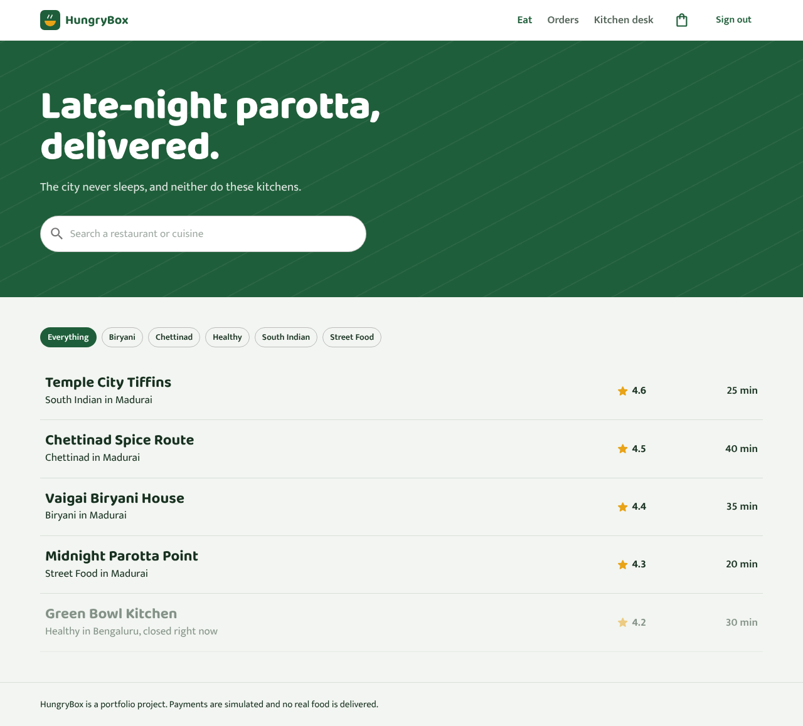
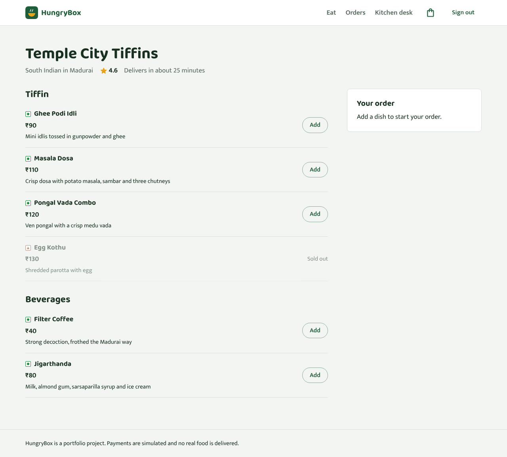
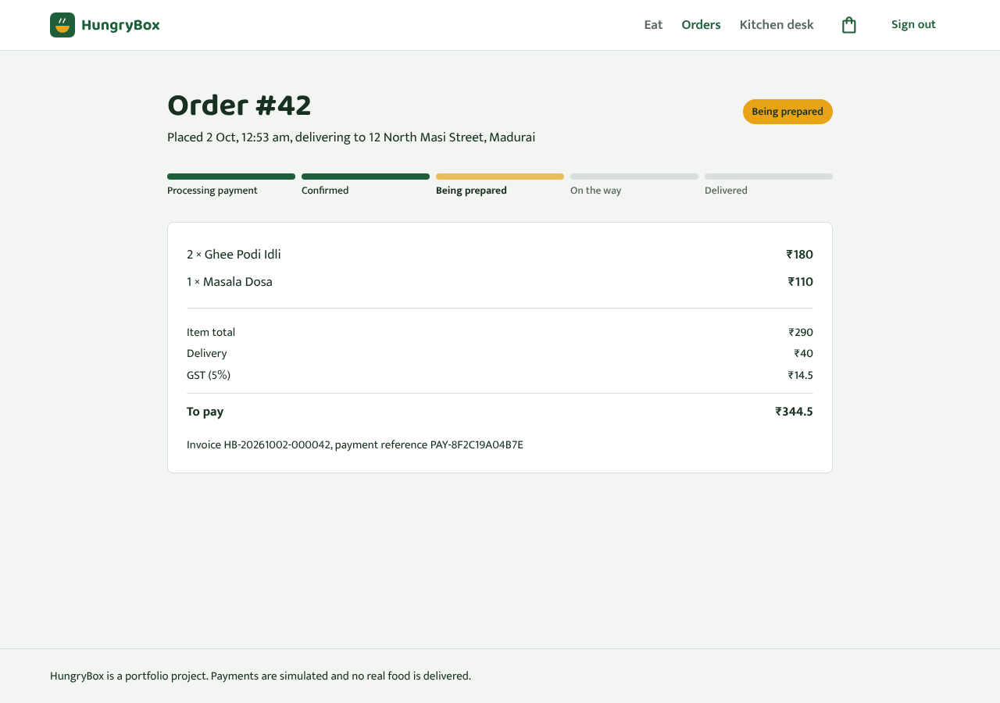
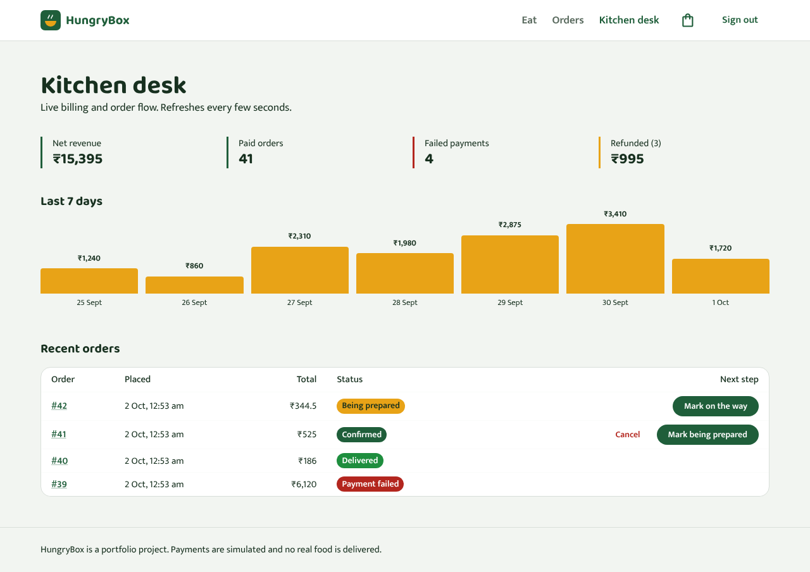
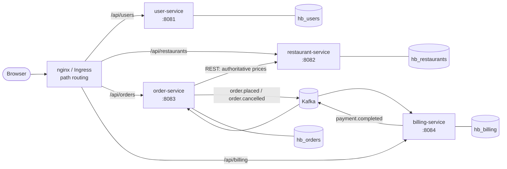
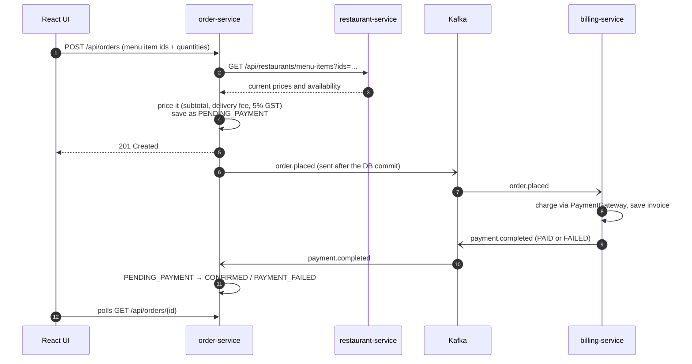

# HungryBox

**An event-driven food delivery platform built with Spring Boot microservices, Kafka, MySQL and React, packaged for Docker Compose and Kubernetes.**

[](https://github.com/Arshath1470/hungrybox/actions/workflows/ci.yml)


Customers browse Madurai kitchens, build a cart and check out. The order is priced on the server, an `order.placed` event goes to Kafka, the billing service charges it and publishes `payment.completed`, and the order flips to *Confirmed* in the customer's tracker within a second. An admin "kitchen desk" moves orders through the kitchen and shows live billing numbers.



| Menu and cart | Live order tracking | Kitchen desk (admin) |
| --- | --- | --- |
|  |  |  |

---

## Architecture



| Service | Owns | Talks to |
| --- | --- | --- |
| **user-service** | Accounts, BCrypt password hashes, JWT issuance, bootstrap admin | none |
| **restaurant-service** | Restaurants, menus, availability (seeded with five kitchens) | none |
| **order-service** | Orders, pricing, status lifecycle | restaurant-service over REST; Kafka |
| **billing-service** | Invoices, payments, refunds, revenue summary | Kafka |
| **frontend** | React + Material UI single-page app, served by nginx | all of the above through the gateway |

Each service has its own schema (database-per-service) managed by Flyway migrations. Services never read each other's tables; they only share the JWT signing secret and the event contracts in [`common/`](common/src/main/java/com/hungrybox/common/events).

### What happens when you place an order



### Design decisions worth talking about

- **Prices never come from the browser.** The client sends item ids and quantities only; order-service fetches authoritative prices from restaurant-service and computes totals with `BigDecimal` and `HALF_UP` rounding ([`PricingCalculator`](services/order-service/src/main/java/com/hungrybox/order/PricingCalculator.java)).
- **Events are published after commit.** Services raise Spring application events inside the transaction and a `@TransactionalEventListener(phase = AFTER_COMMIT)` forwards them to Kafka, so consumers never see an order that was rolled back.
- **Idempotent consumers.** Every event is keyed by `orderId` (per-order ordering on one partition). Billing has a unique constraint on `order_id` and skips duplicates; order-service applies status changes as compare-and-set updates (`WHERE status = :expected`), so redelivered events are harmless.
- **Dead-letter topics.** Listeners retry a failing record three times, then park it on `<topic>.DLT` instead of blocking the partition. Malformed payloads skip the retries.
- **An explicit state machine.** [`OrderStatus`](services/order-service/src/main/java/com/hungrybox/order/OrderStatus.java) defines legal transitions. Admins drive kitchen steps but cannot fake a payment outcome; customers can cancel only before cooking starts, which triggers a refund through billing.
- **Stateless auth at the edge of each service.** user-service issues HS256 JWTs; a shared servlet filter in `common` verifies them and injects the caller with `@CurrentUser`. Other users' orders and invoices return 404, not 403, so their existence isn't leaked.
- **Errors as RFC 9457 problem details**, with per-field validation messages that the UI shows next to the input.

---

## Run it

### With Docker Compose (everything, one command)

```bash
cp .env.example .env          # optional: change passwords and the JWT secret
docker compose up --build
```

Open <http://localhost:8080> and sign in as the seeded admin `admin@hungrybox.dev` / `Admin@12345`, or create a customer account.

The mock payment gateway declines any order above `MAX_TRANSACTION_AMOUNT` (₹5,000 by default), so you can see the failure path by ordering a lot of biryani.

### On Kubernetes

The [`k8s/base`](k8s/base) kustomization deploys MySQL and Kafka as StatefulSets, the four services and the frontend as Deployments, plus an Ingress, a HorizontalPodAutoscaler and a PodDisruptionBudget for order-service.

```bash
# local cluster with an ingress controller
kind create cluster --name hungrybox
kubectl apply -f https://raw.githubusercontent.com/kubernetes/ingress-nginx/main/deploy/static/provider/kind/deploy.yaml

kubectl apply -k k8s/base
kubectl -n hungrybox get pods -w
echo "127.0.0.1 hungrybox.local" | sudo tee -a /etc/hosts   # then open http://hungrybox.local
```

Images are pulled from GHCR (`ghcr.io/arshath1470/hungrybox-*`), which CI publishes on every push to `main`. For a kind cluster you can instead build locally and `kind load docker-image …`. The HPA needs metrics-server installed.

Production touches already in the manifests: non-root containers with a read-only root filesystem and all capabilities dropped, startup, readiness and liveness probes on Spring Boot's health groups, resource requests and limits, zero-downtime rolling updates, init containers that wait for MySQL and Kafka, and Prometheus scrape annotations on `/actuator/prometheus`.

### For development

```bash
docker compose up mysql kafka              # infrastructure only
mvn -pl services/user-service spring-boot:run   # repeat per service, ports 8081-8084
cd frontend && npm install && npm run dev  # http://localhost:5173, proxies /api to the services
```

---

## API

All endpoints are JSON. Send `Authorization: Bearer <token>` from the login response.

| Method | Path | Who | Purpose |
| --- | --- | --- | --- |
| POST | `/api/users/register` | anyone | Create a customer account, returns a token |
| POST | `/api/users/login` | anyone | Sign in, returns a token |
| GET, PUT | `/api/users/me` | signed in | Read or update your profile |
| GET | `/api/restaurants?q=&cuisine=&city=` | anyone | Search restaurants |
| GET | `/api/restaurants/{id}` | anyone | Restaurant with its menu |
| POST | `/api/restaurants`, `/api/restaurants/{id}/menu-items` | admin | Add restaurants and dishes |
| PATCH | `/api/restaurants/menu-items/{id}/availability` | admin | Mark a dish sold out |
| POST | `/api/orders` | signed in | Place an order |
| GET | `/api/orders`, `/api/orders/{id}` | owner | Your orders |
| POST | `/api/orders/{id}/cancel` | owner | Cancel a confirmed order (refunded) |
| GET | `/api/orders/all` | admin | Recent orders across customers |
| PATCH | `/api/orders/{id}/status` | admin | Move to `PREPARING`, `OUT_FOR_DELIVERY`, `DELIVERED` or `CANCELLED` |
| GET | `/api/billing/invoices`, `/api/billing/invoices/order/{orderId}` | owner | Invoices |
| GET | `/api/billing/summary` | admin | Counts, collections, refunds and a 7-day revenue trend |

Every service also exposes `/actuator/health/{liveness,readiness}` and `/actuator/prometheus`.

---

## Tests and CI

```bash
mvn verify                    # unit + integration tests for all services (H2 in MySQL mode, Kafka mocked)
cd frontend && npm test       # Vitest: cart pricing, order status rules, components
```

The integration tests drive real HTTP requests through MockMvc with the JWT filter in place and cover the important flows: server-side pricing, payment success and failure, duplicate event delivery, cancellation and refund, admin-only transitions and cross-customer access.

[GitHub Actions](.github/workflows/ci.yml) runs four stages on every push and pull request:

1. **Backend**: `mvn verify` on JDK 21.
2. **Frontend**: `npm test` and a production build.
3. **Manifests**: renders the kustomization and validates every object against the Kubernetes 1.30 schemas with kubeconform in strict mode, and checks the Compose file.
4. **Images**: builds all five images with BuildKit layer caching; on `main` it pushes them to GitHub Container Registry tagged with the commit SHA and `latest`.

Dependabot keeps Maven, npm, Docker base images and Actions up to date.

---

## Project layout

```
hungrybox/
├── common/                  shared JWT filter, error handling, Kafka event contracts
├── services/
│   ├── user-service/
│   ├── restaurant-service/
│   ├── order-service/
│   └── billing-service/
├── frontend/                React 19 + Material UI + Vite, served by unprivileged nginx
├── docker/                  multi-stage Spring Boot Dockerfile (layered jars), MySQL init
├── k8s/base/                kustomize manifests
├── docker-compose.yml
└── .github/                 CI workflow and Dependabot
```

## Tech stack

Java 21, Spring Boot 3.5 (Web MVC, JDBC, Validation, Actuator), Spring Kafka, Flyway, MySQL 8.4, Apache Kafka 3.9 in KRaft mode, JJWT, Micrometer Prometheus, JUnit 5, MockMvc, H2, React 19, React Router, Material UI, Vitest, Testing Library, Docker, nginx, Kubernetes, kustomize, GitHub Actions, GHCR.

## Ideas for next steps

- Transactional outbox table so events survive a broker outage between commit and publish
- Server-sent events instead of polling for the order tracker
- Testcontainers-based end-to-end test that runs the real Kafka flow in CI
- OpenTelemetry tracing across the HTTP and Kafka hops
- Helm chart and an Argo CD application for GitOps deploys

## License

[MIT](LICENSE)
